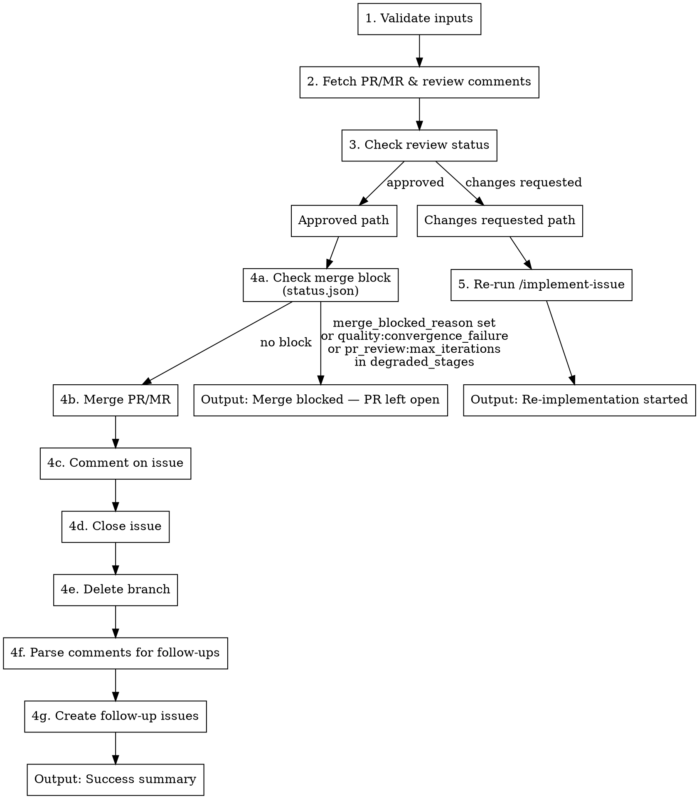

# Process PR/MR

Read PR/MR review comments and act accordingly: if approved, create follow-up issues and merge; if changes requested, re-run implementation.

**Announce at start:** "Using process-pr to process PR/MR #$1 for issue #$2"

**Arguments:**
- `$1` — PR/MR number (required)
- `$2` — Issue number that the PR/MR addresses (required)
- `$3` — Base branch for re-implementation if needed (required)

**Examples:**
- `/process-pr 142 130 aw-next`
- `/process-pr 456 123 main`

## Process



**Why merge first:** Follow-up issues should only be created if the merge succeeds. Creating issues before merge can leave orphaned issues if merge fails (conflict, permissions, etc.). Merging first ensures we only create follow-ups for work that actually landed.

### Step 0: Resolve the Platform Directory

**Two command shapes are refused by the Bash permission check, whatever the allowlist says. Never emit either one in this skill:**

1. **Assignment prefix** — a command that starts with `VAR=` or `VAR="$(…)"` (e.g. capturing the output of `pipeline-core-platform-dir` into a variable).
2. **Default expansion** — any `${VAR:-default}` (or `:=`, `:+`) in a command (e.g. `"${PLATFORM_DIR:-.claude/scripts/platform}/merge-mr.sh"`).

Write every command literally: run each as its own bare command with real values and literal paths substituted for the `<PLACEHOLDERS>`, and read results from the command output rather than capturing them into variables. Pipes and `;` are fine.

Run this as its own bare command:

```bash
pipeline-core-platform-dir
```

Use the path it prints as a literal in every later command, in place of `<PLATFORM_DIR>`. If the command is not found, use `.claude/scripts/platform`.

### Step 1: Validate Inputs

```bash
# Verify PR/MR exists and is open
"<PLATFORM_DIR>/read-mr-comments.sh" <PR_NUMBER>

# Verify issue exists and is open
"<PLATFORM_DIR>/read-issue.sh" <ISSUE_NUMBER>
```

**If validation fails:** Stop and report error.

### Step 2: Fetch PR/MR & Comments

```bash
# Get PR/MR comments
"<PLATFORM_DIR>/read-mr-comments.sh" <PR_NUMBER>
```

**Extract:**
- All PR/MR comments (for review status and follow-up issue extraction)
- PR/MR metadata (title, branch, state)

### Step 3: Parse Review Status from Comments

**IMPORTANT:** Review status is embedded in PR/MR comments by the `implement-issue` skill. Fetch the comments with one bare command and read the status from its output yourself — do not capture it into a variable or pipe it through a shell function:

```bash
"<PLATFORM_DIR>/read-mr-comments.sh" <PR_NUMBER>
```

Scan the comments in chronological order. The LAST comment that carries a status marker wins (it is the most recent review). Match markers in the priority order listed below.

If no comment carries any marker, stop and report: `ERROR: No review status found in PR/MR #<PR_NUMBER> comments. Expected a comment containing '**Status: APPROVED**', '**Status: CHANGES_REQUESTED**', or the orchestrator's '**Result:** approved'/'**Result:** changes_requested' format.`

Otherwise note the status (`APPROVED` or `CHANGES_REQUESTED`) and continue.

**Status priority:**
1. `**Status: APPROVED**` (markdown bold - preferred)
2. `**Status: CHANGES_REQUESTED**` (markdown bold - preferred)
3. `Status: APPROVED` (plain text - fallback)
4. `Status: CHANGES_REQUESTED` (plain text - fallback)
5. `**Result:** approved` (orchestrator's `comment_pr` PR-review format - fallback)
6. `**Result:** changes_requested` (orchestrator's `comment_pr` PR-review format - fallback)

**Multiple reviews:** The algorithm processes comments in chronological order. The LAST status found wins, representing the most recent review.

---

## If Approved: Merge Path

### Step 4a: Check for Merge Block

Before the orchestrator merges, check whether a convergence-failure block is in effect. Run each check below as its own bare command, with a literal path (`status.json` in the current directory, or the full path if it lives elsewhere). If the file does not exist, there is no block — skip to Step 4b.

First, check whether the emergency override is set:

```bash
printenv BLOCK_MERGE_ON_CONVERGENCE_FAILURE
```

If it prints `0`, skip the rest of this step (restores the pre-fix behaviour for emergency overrides) and proceed to Step 4b. If it prints nothing or any other value, continue.

Then read the block signals, in this order, stopping at the first that produces output:

```bash
jq -r '.merge_blocked_reason // empty' status.json
```

```bash
jq -r '(.degraded_stages // [])[] | select(startswith("quality:convergence_failure"))' status.json
```

```bash
jq -r '(.degraded_stages // [])[] | select(startswith("pr_review:max_iterations"))' status.json
```

```bash
jq -r '(.degraded_stages // [])[] | select(startswith("quality:fix_failed"))' status.json
```

- `merge_blocked_reason` — the explicit reason written by the orchestrator.
- `quality:convergence_failure` — the reviewer repeatedly flagged the same issues without resolution.
- `pr_review:max_iterations` — the PR-review loop exhausted its iterations without an approved verdict.
- `quality:fix_failed` — a quality-loop fix stage failed, so the findings were never resolved.

**If any command printed a block reason:** report it in your output as `MERGE BLOCKED: <the text the command printed>`, then post a comment on the PR explaining why it was not merged, using the quoted heredoc form with the reason written in literally:

```bash
"<PLATFORM_DIR>/comment-mr.sh" <PR_NUMBER> "$(cat <<'EOF'
## Merge Blocked — Unresolved Quality Feedback

This PR was **not** merged automatically because the quality loop did not converge.

**Block reason:** <the text the command printed>

Human review is required before merging. Address the unresolved feedback, then re-run the pipeline or merge manually once the issues are resolved.
EOF
)"
```

Leave the PR open, do NOT close the issue or delete the branch, and output `merge_blocked` status (see Output section).

### Step 4b: Do NOT merge — return `approved`

**You do not perform the merge.** The orchestrator merges in shell via `merge-mr.sh` after you return (issue #853).

Do the remaining review work below (Step 4f/4g — parse comments, create follow-up issues), then output status **`approved`**. Skip Step 4c (the "Completed" comment) and Step 4d (closing the issue): both are the orchestrator's job now, because only it knows whether the merge actually succeeded.

**Why this changed.** The merge used to be performed here, by you, following an instruction to run `merge-mr.sh`. An instruction is not a gate: a run that shelled out to `gh pr merge` directly bypassed the check-failure refusal inside `merge-mr.sh` and put a PR with a failing `e2e` check onto the base branch (#848). On repos that cannot enable branch protection, that refusal is the only gate there is. Moving the merge into the orchestrator puts it on the single path that always runs it.

A PreToolUse hook now hard-blocks direct `gh pr merge` / `glab mr merge`, so attempting the merge yourself will fail regardless.

**Do NOT check `mergeStateStatus` yourself.** The `UNKNOWN` value is transient (can persist 2–30 s while GitHub recomputes merge status) and is not a reliable signal. Mergeability polling belongs to `merge-mr.sh`, which the orchestrator invokes.

**If the review did not pass:** return `changes_requested` or `merge_blocked` as described elsewhere — not `approved`.

### Step 4c: Comment on Issue

```bash
"<PLATFORM_DIR>/comment-issue.sh" <ISSUE_NUMBER> "$(cat <<'EOF'
## Completed

Resolved via PR/MR #$PR_NUMBER (merged).

### Follow-up issues created:
- #XXX - Description
- #YYY - Description

(Or "No follow-up issues needed.")
EOF
)"
```

### Step 4d: Close Issue

```bash
"<PLATFORM_DIR>/transition-issue.sh" <ISSUE_NUMBER>
```

### Step 4e: Delete Branch

The merge script may handle branch deletion. Verify:

```bash
git ls-remote --heads origin <BRANCH_NAME>
```

If still exists:
```bash
git push origin --delete <BRANCH_NAME>
```

### Step 4f: Parse Comments for Follow-up Issues

Scan all review comments for indicators of follow-up work:

**Trigger phrases:**
- "create issue for..."
- "follow-up needed:"
- "out of scope but should..."
- "technical debt:"
- "future improvement:"
- "TODO:" (in comments, not code)
- "nice to have:"
- "consider adding:"

**Follow-up classification — determine type before extracting:**

| Classification | Criteria | Action |
|---|---|---|
| **precise** | References a specific file or function AND covers ≤2 files in scope | Create issue immediately — no `needs-explore` label; context is already specific enough |
| **vague** | No file/function reference, broad scope, or uses open-ended trigger phrases alone | Create issue immediately with `needs-explore` label — a later `/enrich-issue` sweep researches and fleshes out the body |

> **Deprecation notice:** A previous version of this skill invoked `/explore` as a nested Claude CLI process to enrich vague follow-ups before creating them. That path is removed. The `batch-orchestrator.sh --enrich-followups` flag now handles enrichment asynchronously via the `enrich-issue` skill, which is idempotent and rate-limit-safe.

Open-ended trigger phrases that signal a **vague** follow-up (create with `needs-explore` label):
`"consider adding:"`, `"nice to have:"`, `"future improvement:"`, `"we could also..."`

Examples:

```
# PRECISE — create issue immediately (no needs-explore label)
"follow-up needed: extract retry logic in scripts/merge-mr.sh:handle_merge() into a shared helper"
"technical debt: auth/token.sh:validate_token doesn't handle clock skew — add leeway param"

# VAGUE — create issue immediately WITH needs-explore label (enrich-issue sweep fleshes out later)
"consider adding more tests"
"future improvement: better error handling throughout"
"nice to have: improve logging"
```

**Extract for each:**
- Title (short description)
- Body (full context from comment)
- Labels (inferred: bug, enhancement, tech-debt)

### Step 4g: Create Follow-up Issues

> **CRITICAL — NEVER use `gh issue create` or `create-issue.sh` directly.** Every follow-up issue MUST go through `create-followup-issue.sh`. It runs `assert_issue_valid` fail-closed before creation, ensuring the body has parseable task lines, a known agent, a resolvable file path, and an `## Acceptance Criteria` section. Writing bodies by hand and bypassing this script produces malformed issues that stall the pipeline and require manual remediation. If `create-followup-issue.sh` exits non-zero for any reason (missing argument, validation failure), log the error and skip that item — do NOT fall back to `gh issue create`.

For each extracted issue, invoke the platform wrapper `create-followup-issue.sh` as a bare command, using the literal path resolved in Step 0 (no assignment, no default expansion, no `||` fallback):

```bash
"<PLATFORM_DIR>/create-followup-issue.sh" \
  --title "<ISSUE_TITLE>" \
  --description "<EXTRACTED_DESCRIPTION>" \
  --task-description "<INFERRED_TASK_DESCRIPTION>" \
  --file-path "<FILE_PATH>" \
  --pr-number <PR_NUMBER> \
  --issue-number <ISSUE_NUMBER> \
  --reviewer "<REVIEWER>" \
  --labels "<LABELS>" \
  --type precise   # or: --type vague (adds needs-explore label)
```

The wrapper prints the created issue number on stdout — record that number from the command output (do not capture it with `$(…)`). Exit code 1 means either a duplicate (a similar open issue already exists) or an invalid body (the generated body failed `assert_issue_valid`): nothing was created and nothing was printed. This is not a failure of the review or merge; log the item and skip it (do not retry via `gh issue create`). Exit 3 means a usage error (missing or invalid argument). Collect each number the wrapper printed on a successful run; these numbers fill the `follow_up_issues` array in the final status output.

**Never put a line starting with `#` inside a quoted argument.** A multi-line quoted argument (such as `--description` or `--task-description`) with a line that begins with a hash is denied by the Bash permission check, because it can hide a comment from the command parser. If the text needs such a line (a markdown heading, say), do not inline it in a double-quoted string. Pass it with the quoted heredoc form instead, which keeps the text literal:

```bash
"<PLATFORM_DIR>/create-followup-issue.sh" \
  --title "Short title" \
  --description "$(cat <<'EOF'
## Context
Text that may contain lines starting with a hash.
EOF
)" \
  --file-path "path/to/file" \
  --pr-number <PR_NUMBER> \
  --issue-number <ISSUE_NUMBER> \
  --type precise
```

**`--file-path` is required** — extract it from the `[File:Line]` reference in the review comment. If the review item mentions a function or concept but no file path, use the primary file changed in the PR/MR diff as the fallback. If no file can be determined at all, pass `"."` (the script will infer agent `"default"` and the issue will be valid). Never omit `--file-path`.

Log each: `Created follow-up issue #XXX: "$TITLE"` (or `"$TITLE" (needs-explore)` for vague items).

---

## If Changes Requested: Re-implementation Path

### Step 5: Re-run implement-issue

When the code reviewer requests changes, spawn a new implementation session:

```bash
claude --dangerously-skip-permissions \
  --print \
  "/implement-issue <ISSUE_NUMBER> <BASE_BRANCH>" \
  2>&1 | tee -a logs/process-pr-rerun.log
```

**Notes:**
- The implement-issue skill will:
  - Read the existing PR/MR and review comments
  - Address the requested changes
  - Push to the same branch (updating the PR/MR)
  - Run code review again
- After implement-issue completes, call `/process-pr` again to check the new review

**Log:**
```
Changes requested on PR/MR #$PR_NUMBER. Re-running implementation for issue #$ISSUE_NUMBER...
```

---

## Output

### Success (Approved & Merged)

```
## Process PR/MR Complete

**PR/MR:** #$PR_NUMBER
**Issue:** #$ISSUE_NUMBER
**Status:** ✅ Merged

### Actions Taken
- [x] Review status: APPROVED
- [x] Merge block check: no block
- [x] Created N follow-up issues
- [x] PR/MR merged
- [x] Issue #$ISSUE_NUMBER closed
- [x] Branch deleted

### Follow-up Issues Created
| Issue | Title | Labels |
|-------|-------|--------|
| #XXX | Description | enhancement |
```

### Merge Blocked (Convergence Failure)

```
## Process PR/MR: Merge Blocked

**PR/MR:** #$PR_NUMBER
**Issue:** #$ISSUE_NUMBER
**Status:** ⛔ Merge blocked — PR left open

### Block Reason
$MERGE_BLOCKED_REASON

### Actions Taken
- [x] Review status: APPROVED
- [x] Merge block check: BLOCKED
- [ ] PR/MR merge — SKIPPED (blocked)
- [ ] Issue close — SKIPPED (blocked)
- [ ] Branch delete — SKIPPED (blocked)

### Next Steps
Human review is required. Address the unresolved quality feedback listed above,
then merge manually or re-run the pipeline once the issues are resolved.
```

### Re-implementation (Changes Requested)

```
## Process PR/MR: Changes Requested

**PR/MR:** #$PR_NUMBER
**Issue:** #$ISSUE_NUMBER
**Status:** 🔄 Re-implementing

### Review Feedback
$REVIEW_COMMENTS_SUMMARY

### Action
Re-running /implement-issue $ISSUE_NUMBER $BASE_BRANCH to address requested changes.
```

## Error Handling

| Failure Point | Action |
|---------------|--------|
| Validation fails | Stop, report error |
| No review status in comments | Stop, report - need code review comment with Status line first |
| `merge_blocked_reason` set in `status.json` | Leave PR open, post block comment, return `merge_blocked` — do NOT close issue or delete branch |
| `quality:convergence_failure` in `degraded_stages` | Same as above (fallback when `merge_blocked_reason` absent) |
| `pr_review:max_iterations` in `degraded_stages` | Same as above — PR-review loop exhausted iterations without an approved verdict (fallback when `merge_blocked_reason` absent) |
| Issue creation fails (`create-followup-issue.sh` exits non-zero) | Log warning, skip that item — NEVER fall back to `gh issue create` or `create-issue.sh` |
| Merge fails | Stop, return failure, do NOT close issue |
| Issue close fails | Log warning (merge succeeded) |
| Branch delete fails | Log warning (best-effort) |
| Re-implementation fails | Log error, include in output |

## Integration

**Called by:**
- `handle-issues` skill (after implement-issue creates PR/MR)
- User directly via `/process-pr <pr> <issue> <branch>`

**Calls:**
- `/implement-issue` (when changes requested)

**Requires:**
- Platform CLI authenticated (gh, glab, or acli — configured in .claude/config/platform.sh)
- PR/MR must exist with a code review comment containing `**Status: APPROVED**`/`**Status: CHANGES_REQUESTED**` or the orchestrator's `**Result:** approved`/`**Result:** changes_requested` format
- Issue must exist and be open

## Example Sessions

### Approved PR/MR

```
User: /process-pr 142 130 aw-next

Claude: Using process-pr to process PR/MR #142 for issue #130

Validating... PR/MR #142 open, Issue #130 open
Parsing comments... Status: APPROVED, 1 follow-up found
Creating issue #145: "Add rate limiting to auth endpoint"
Merging PR/MR #142... Merge successful
Closing issue #130... done
Deleting branch issue-130-auth-redirect... done

## Process PR/MR Complete
PR/MR: #142 | Issue: #130 | Status: Merged
Follow-up: #145 - Add rate limiting to auth endpoint
```

### Changes Requested

```
User: /process-pr 142 130 aw-next

Claude: Using process-pr to process PR/MR #142 for issue #130

Validating... PR/MR #142 open, Issue #130 open
Parsing comments... Status: CHANGES_REQUESTED
Feedback: "Need to handle edge case when session expires"

Re-running /implement-issue 130 aw-next...
[spawns headless session]
```

## Machine-Readable Result Output

When invoked via `batch-orchestrator.sh` with `--json-schema`, this skill's output is parsed for structured data. To ensure reliable extraction, **always end your execution with a clear result statement**.

### Final Result Output

At the **very end** of execution, output a clear status summary. This helps `--json-schema` reliably extract the structured output.

**On successful merge:**
```
## Result

Status: merged
Follow-up issues: #145, #146
```

**On merge with no follow-ups:**
```
## Result

Status: merged
Follow-up issues: none
```

**On changes requested:**
```
## Result

Status: changes_requested
```

**On merge blocked (convergence failure):**
```
## Result

Status: merge_blocked
Error: Quality loop convergence failure recorded in degraded_stages: quality:convergence_failure:quality:iter=2
```

**On error:**
```
## Result

Status: error
Error: Merge failed - conflict with base branch
```

**On rate limit:**
```
## Result

Status: rate_limit
Error: Platform API rate limit exceeded
```

### Result Schema

The `batch-orchestrator.sh` uses this JSON schema to extract results:

```json
{
  "type": "object",
  "properties": {
    "status": {"enum": ["approved", "merged", "changes_requested", "merge_blocked", "error", "rate_limit"]},
    "follow_up_issues": {"type": "array", "items": {"type": "string"}},
    "error": {"type": "string"}
  },
  "required": ["status"]
}
```

**Important:** The final result section must be the last significant output. The `--json-schema` flag asks Claude to summarize the execution according to this schema, so ending with a clear status makes extraction reliable.

## Red Flags

| Temptation | Why It Fails |
|------------|--------------|
| Call `gh issue create` directly for a follow-up | Bypasses `assert_issue_valid` — produces bodies with no task lines, no agent, no ACs; stalls the pipeline and requires manual remediation |
| Call `create-issue.sh` with a hand-written body | Same bypass — `create-issue.sh` only gates bodies that already contain `## Implementation Tasks`; a prose body has no such marker and slips through unvalidated |
| Omit `--file-path` because no file was mentioned | `create-followup-issue.sh` exits 3 (missing arg); pass `"."` as fallback to get `default` agent inference — never omit the flag |
| Write the issue body inline before calling the script | The script generates and validates the body deterministically from its arguments; writing a body manually defeats the entire purpose |
